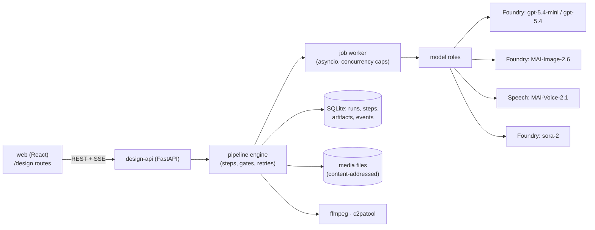

# Design Studio: Development Plan (for review)

**Status:** approved 2026-10-05 (D1–D9, Friday scope: video + image + voice + history, home-server
service principal). Build started. Clickable mockup: [ux-mockup.html](ux-mockup.html) (open it in a browser; 11 screens; "Design notes" can be
toggled off). Mockup source: `mockup-src/template.html`; rebuild with
`python3 mockup-src/build.py`.
**Owner:** Yuexin Mao · **Lives in:** Applied AI Studio, branch `feat/module-8-media` (replaces the
Promo Studio page)

---

## Progress (2026-10-05)

- Built ahead of plan: the engine, run history, bundles and **all four pipelines** (article moved up
  from phase 3 at your request), each verified live on Foundry (gpt-5.4-mini/gpt-5.4, MAI-Image-2.6,
  Sora 2, MAI-Voice-2.1-Flash with speech-to-text listen-back).
- Module 8 round 1 and round 2, the design sheet and the brand test are imported into history.
- 26 backend tests on offline fakes; typecheck and lint clean.
- Next: home-server deployment (service principal, compose, nginx), example runs, rehearsal.
- Listen-back uses Azure Speech speech-to-text on the same resource, so no `gpt-4o-transcribe`
  deployment is needed.

## 1. What it is

**Design Studio** is the Applied AI Studio workspace for **multi-step generative pipelines** with a
human gate at each important step and a **run history** you can reopen, fork, compare and export.

It is **not** a model playground. The Foundry playgrounds already cover single calls (chat, compare,
one image, one video). Design Studio covers what happens *around* the calls:

- briefs and templates
- shot lists and outlines
- multiple takes or versions
- your keep / regenerate / revise decisions
- automatic checks that *flag* but never decide
- assembly
- labels and provenance
- a permanent record of every run

**Audiences:**
1. You, demoing in class and at work.
2. Students, who connect their **own** Foundry resource, the same model as the AI Fit Analyzer needing Copilot.
3. A customer audience: the same app, framed as "how a content team should run GenAI."

**Where it runs:**
- **Local Mac:** primary. Uses `az login`.
- **Home server:** backup for class and remote demo, behind the existing Cloudflare Access. The
  university laptop then needs only a browser, not an Azure sign-in. Recorded runs replay with no
  Azure credentials. Live runs on the server use a scoped service principal.
- **History** stays with each install and moves between them as export/import bundles.

## 2. Scope decisions (proposed; please confirm)

| # | Decision | Proposal |
|---|---|---|
| D1 | Promo Studio page | **Retire it.** Its step-by-step teaching story moves to the use-case **Demo** page (as you suggested); Design Studio replaces the tool |
| D2 | Pipelines in v1 | **Video, Image, Voice, Article** (order of value: video › image › voice › article) |
| D3 | Run history | Every run is saved: brief, settings, model deployment + version, prompts, outputs, checks, your decisions, event log. **Open · Fork · Compare · Export · Delete · Restrict** |
| D4 | Import existing work | Import Module 8 round 1 and round 2 as video runs, the SOLENNE design sheet as an image run, and the 20 NASA articles as article runs, so history is full on day 1 |
| D5 | Model roles | Pipelines ask for a **role** (text-draft, text-judge, image, voice, transcribe, video). Settings map roles to Foundry deployments, so swapping Sora later is configuration only |
| D6 | Video engine after Oct 15 | Keep the role. If no video deployment exists, the video pipeline runs in **replay mode** (history only) and says why |
| D7 | Students | Not in v1's hosting. A student guide + `.env` template to run Studio locally against their own Foundry resource (phase 4) |
| D8 | Cost | Show **generated seconds / images / characters**, not dollars, until you enter a rate table in Settings (we don't invent prices) |
| D9 | Restricted runs | A run (e.g. the brand-name test) can be marked Restricted: visible in history, never exported or shown on public builds |

## 3. The four pipelines

Each is a fixed sequence of **steps**; ✋ marks a **gate** where the run pauses for you.

| Pipeline | Steps | Models (roles) | Checks that flag |
|---|---|---|---|
| **Video** (ad / promo / previz) | brief → ✋shot list → ✋keyframes (product shots) → ✋takes (N per shot; keep / regenerate / remix) → voiceover (opt.) → assemble → label + C2PA | text-draft, image, video, voice | motion, silent audio, design drift / cast mismatch (vision model, optional), Content Credentials |
| **Image** (key art / stills) | brief (use case, references with a role each: subject / style / scene, must-not-include, size, count) → prompt (LLM helper, ✋ editable) → ✋candidates → ✋**iterate** on a version tree (revise any version with a note + references, regenerate, variations; branch from any version) → finish (title overlay, label, C2PA, export or send to a video run) | text-draft, image (+ optional 2nd/3rd image model) | content-filter outcome, C2PA, optional vision check against "must not include" |
| **Voice** (podcast / narration) | brief → ✋script (speakers, lines, styles) → cast voices → synthesize per line → listen-back → ✋fix lines → mix + label | text-draft, voice, transcribe | word mismatches script vs transcript, silence, loudness |
| **Article** (report / summary) | brief + sources → outline → ✋draft → critique (claims vs sources) → ✋revise (with a note) → … → approve + label | text-draft, text-judge | unsupported / partly-supported claims, length and format rules |

Pipelines connect. A kept image can become a video keyframe, and an approved script can become a voice run.

**Image vs video.** They are separate pipelines on one engine, with one run store and one history.
The video pipeline's keyframe step reuses the image pipeline's "edit and pick" component (same
version tree, same MAI calls). Takes are a Sora step that image runs never have. Any kept image can
start a video run as its reference (mockup screens 7a and 7b).

## 4. Architecture

- **design-api** grows out of the existing `services/media-api` (same FastAPI service, same
  conventions): it already has the MAI-Image client with backoff, filter-block handling, Sora
  create/poll/download and daily caps.
- **Engine:** each pipeline is a Python class declaring steps; a step is `run → produces artifacts →
  (gate?)`. Runs are a state machine: `draft → running → waiting_for_review → running → completed |
  failed | canceled`.
- **Jobs:** in-process asyncio worker with per-role concurrency, e.g. video limited to 2 at a time
  (Sora rejects more), image limited to 6 per minute. Video jobs save the vendor's job id before
  polling, so **a restart resumes** instead of re-generating, which fixes what happened overnight on Oct 5.
- **Live updates:** server-sent events per run (progress, events, new artifacts). The page also
  works by polling, for proxies that buffer.
- **Storage:**
  - SQLite holds runs, steps, artifacts, decisions and events.
  - Media files sit beside it, named by sha256.
  - Data folder: `~/Library/Application Support/AppliedAIStudio/design` on the Mac,
    `/srv/appdata/applied-ai-studio/design` on the server.
- **Auth to Azure:**
  - `DefaultAzureCredential` everywhere.
  - On the Mac it uses `az login`.
  - On the server it uses a **service principal** with only *Cognitive Services User* on `kestrel-ai` and
    `aifoundry-image-studio-ymao`, its secret mounted only into `design-api`.
  - No keys in the repo or the browser.
- **Hosting:** a new `design-api` container in the existing compose (read-only filesystem, a writable
  volume for the data folder, memory limit ~768 MB, ffmpeg + c2patool installed). Nginx route
  `/api/design/*` with buffering off for SSE. Same Cloudflare Access owner-only protection.

### Data model (sketch)

| Table | Key fields |
|---|---|
| `runs` | id, pipeline, title, template, brief (JSON), settings (JSON), status, parent_run_id (fork), tags, restricted, created/updated, counters (seconds, images, chars) |
| `steps` | run_id, index, kind, status, gate_state, started/finished, error |
| `artifacts` | step_id, kind (shot list, keyframe, take, line, version, final…), file sha256 + path, model role, deployment + version, prompt, vendor job id, generation seconds, metrics (JSON), checks (JSON) |
| `decisions` | artifact_id, verdict (keep / regenerate / remix / approve / revise), checklist ticks, note, at |
| `events` | run_id, at, level, code (rate_limit, filter_block, retry, slot_wait…), message |

### API (sketch)

`GET /status` (roles, caps, health) · `GET /templates` · `POST /runs` · `GET /runs?filters` ·
`GET /runs/{id}` · `GET /runs/{id}/events` (SSE) · `POST /runs/{id}/steps/{step}/approve` ·
`POST /artifacts/{id}/decision` · `POST /artifacts/{id}/regenerate|remix` ·
`POST /runs/{id}/fork` · `GET /runs/{id}/export` (zip) · `POST /runs/import` ·
`POST /runs/{id}/restrict` · `DELETE /runs/{id}` · `GET /media/{sha}`

## 5. Phases and schedule

Class is **Fri Oct 9**. Sora inference ends **Thu Oct 15**. So video work should come first and be
recorded while Sora still works.

| Phase | When | Delivers | Done when |
|---|---|---|---|
| **0 · Review** | Mon Oct 5 | This plan + mockup approved, D1–D9 settled | Your sign-off |
| **1 · Foundation + Video** | Tue–Wed Oct 6–7 | design-api skeleton (store, jobs, roles, caps, SSE), **Video pipeline end to end**, Run history (list, open, fork, export/import, restrict), import of round 1/2 | You can start a video run on the Mac, close the browser, reopen it from history, review takes, assemble, and export |
| **2 · Image + Voice + server** | Wed–Thu Oct 7–8 | Image pipeline (candidates, edit passes with references, title, C2PA); Voice pipeline (script, cast, per-line synthesis, mix); **home-server deploy** (compose, nginx, data volume, history imported from the Mac; live calls if the service principal is approved). Freeze Thu 6 pm, then rehearse from a browser that's not signed in to Azure | 2–3 example runs of each in history, on the Mac **and** the server |
| **Fri Oct 9** | Class | Demo from history (recorded runs) + **one live run** (image or voice; video live only if you want). Mac is primary; home server is the backup | — |
| **3 · Article + Compare** | Oct 12–14 | Article pipeline with critique and version diff; Compare runs view; listen-back check (needs a transcribe deployment) | Article run with ≥2 versions; compare round 1 vs 2 |
| **4 · Students + operations** | Oct 14–16 | Student setup guide + `.env` template, Restricted runs hidden on public builds, operator runbook (backup/restore, secret rotation) | A fresh install runs with a student's own resource |
| **5 · Hardening** | Oct 19+ | Engine-swap for video after Sora (when a model exists), cost-rate table, accessibility pass, docs, release notes | — |

**Before Friday, you'd have:** Video, Image and Voice pipelines; full run history with Module 8
imported; a few new example runs; the same history on the home server as a backup. Article and
Compare come next week. If that's too tight, the fallback is Video + history (Mac and server) by
Friday, and everything else after.

## 6. Quality bar ("high standard")

- **Tests:**
  - pytest for the engine: state machine, gates, resume after restart, caps, retries.
  - Mocked Foundry clients for every vendor behavior we've seen: 429, filter blocks, "too many
    running tasks", expired downloads, timeouts.
  - React component tests for the history and review views.
- **End-to-end:** Playwright runs a full video pipeline against mocks, plus one smoke test against real
  Foundry, run by hand.
- **Resilience:**
  - No lost work on browser refresh, server restart or laptop sleep. Vendor job ids are saved before polling.
  - Downloads happen immediately, because Azure deletes Sora outputs after 24 hours.
- **UX:**
  - 1440 px projector-first and usable at 390 px.
  - No horizontal overflow, keyboard reachable, WCAG AA contrast.
  - Every wait shows progress and what's happening.
- **Honesty:**
  - Checks say what they're based on.
  - No invented numbers or prices.
  - Every artifact records its model deployment, version and date.
- **Security:**
  - Keys never reach the browser.
  - Owner-only through Cloudflare Access on the server.
  - Daily caps.
  - Restricted runs are excluded from exports and public builds.
- **Docs:** README section, ADR for "design-api replaces media-api", operator runbook (backup and
  restore the data folder, rotate the service principal secret).

## 7. Risks

| Risk | Mitigation |
|---|---|
| Sora retires Oct 15; no replacement video model in your subscription yet | Generate this week; replay mode afterward; video role stays swappable |
| MAI-Image filter blocks harmless prompts | Show the block as an event with a "reword" button; keep the blocked prompt in history |
| Schedule is tight before Friday | Must-haves: phase 1 (video + history) and the server backup. Image and voice can slip without breaking class |
| Home server is Linux/amd64, the Mac is arm64 | Build the image with the existing release script; ffmpeg and c2patool from distro or release binaries; first server deploy Wednesday so Thursday is for fixes |
| Wi-Fi or Cloudflare problem in the classroom | Final ad and key runs also exported as files on a USB stick; the deck already embeds the stills |
| Storage grows with video | Show the size in History; per-run delete; export before deleting |

## 8. What I need from you

1. Approve or change **D1–D9** (especially D1: retire Promo Studio; D2: four pipelines; D4: import existing work).
2. Pick the **Friday scope**: Video + Image + Voice + history *(proposed)*, or Video + history only.
3. OK to create the **service principal** for the home server **this week** (only *Cognitive Services User* on the two resources). Without it, the server still works as a replay backup; it just can't make live calls.
4. Any screen in the mockup you'd change before I start (layout, naming, what's on Home).
